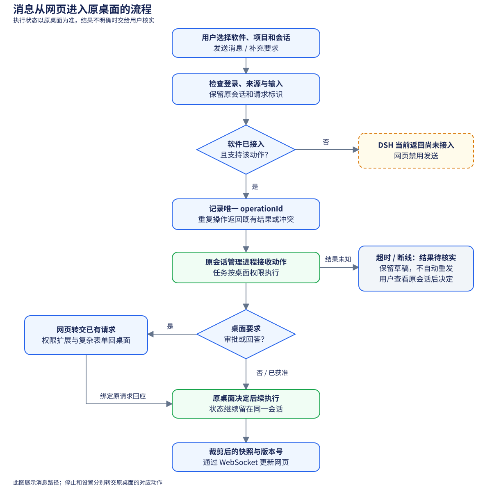
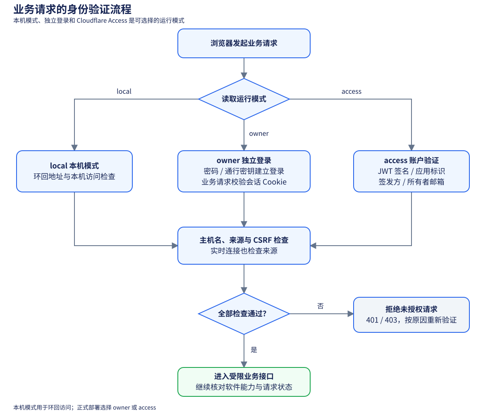

# 当前架构

## 1 产品定位

Agent Control 把现有桌面 Agent 的项目、会话和执行状态接入浏览器，执行、排队和审批权限由原桌面管理

网页网关提供登录验证、业务动作、操作去重和裁剪后的实时更新，当前真实接入为 Codex，DSH 保留独立入口与能力边界

下图展示 Windows 桌面、本机网关、可选远程入口和原 Codex 桌面之间的关系：

图 1.1 当前组件和连接

实线箭头表示现有链路，虚线箭头表示准备中的 DSH 连接。网关及原 Codex 桌面运行在同一 Windows 用户下；远程入口由使用者配置，图中的服务商选项不代表已建立公网隧道

桌面程序通过后台控制器管理本机网关及用户自行提供的 NATAPP 客户端。其他隧道客户端由使用者管理。远程设备使用自己的 HTTPS 地址访问网关，本机模式只适合环回访问。首次远程配置、登录方式和各服务商的配置边界见 [桌面开发说明](DESKTOP.md)

## 2 组件职责

表 2.1 源码职责

| 组件 | 源码 | 负责的行为 |
| --- | --- | --- |
| 网页 | `src/App.tsx`、`src/Auth.tsx` | 项目会话、聊天、登录、模型设置和请求表单 |
| 手机适配 | `src/mobile.ts`、`src/mobile.css` | 可见视口、抽屉、短屏布局、焦点和滚动 |
| 业务网关 | `server/app.ts` | 允许清单中的查询与控制动作、实时连接 |
| CLI 终端 | `src/CliTerminal.tsx`、`server/cli-terminal.ts`、`server/cli-pty-worker.cjs` | 网页终端、认证连接及网关电脑上的 Codex CLI 进程 |
| 登录与请求校验 | `server/security.ts`、`server/owner-auth.ts` | 登录会话、通行密钥、来源与防伪校验 |
| 软件注册 | `server/harness.ts` | 选择适配器，核对能力，隔离原生标识 |
| Codex 适配 | `server/desktop-adapter.ts` | 桌面工具桥、命名管道、只读目录补充和权限保留 |
| 展示转换 | `server/normalizer.ts`、`shared/merge-view.ts` | 裁剪内容、分页、去重合并与旧版本处理 |
| 网关数据 | `server/store.ts` | 偏好、操作摘要和去重；登录表由登录模块管理 |

Codex 使用本机命名管道 `codex-ipc` 提供会话快照与更新，桌面工具桥提供目录和会话动作。适配器尝试数字格式的 `26.x` 版本，并在连接时检查必要的只读接口；允许尝试不代表写操作已经逐项验证

CLI 终端通过单独的认证实时连接启动网关电脑上的 Codex CLI，使用当前项目目录或网关电脑的用户目录。图 1.1 主要展示桌面会话链路，未单独画出 CLI 进程

## 3 消息流转

消息携带唯一操作标识进入原会话，后续输出由桌面通过实时订阅回到网页：

图 3.1 消息进入原桌面的流程

发送消息、补充要求、停止、设置和请求回应使用各自明确的业务动作，停止绑定当前轮次，审批绑定原会话、轮次和请求

重复操作返回已有结果或冲突，超时与断线后的结果需要核实，浏览器重连恢复订阅并保留草稿，桌面中的任务继续运行

WebSocket 是浏览器与网关之间的持续消息连接，推送带有管理进程标识摘要和版本号，较早快照不会覆盖当前输出

## 4 身份验证

运行模式决定业务请求如何证明身份，随后共同检查主机名、来源与提交校验信息：

图 4.1 业务请求校验

`local` 依赖本机环回限制，`owner` 使用密码或通行密钥建立登录会话，`access` 验证 Cloudflare 签名身份令牌

JWT 是 Access 提供的签名身份令牌，CSRF 校验用于阻止其他网页借用浏览器登录状态提交请求

正式模式使用 HTTPS，首次初始化和恢复路径见 `DEPLOYMENT.md`，登录页及必要的静态文件可以在独立登录前加载

## 5 接入状态

Codex 已有真实桌面适配，多 Agent 注册、能力检查、HTTP 业务查询、实时流、偏好与草稿隔离已具备

DSH 仍需要完成原 Desktop Host 的认证、项目会话发现、历史转换、实时订阅和控制动作，具体约定见根目录 `ADAPTERS.md`

图源在 `scripts/diagram-data.mjs`，运行 `npm run diagrams` 会同时生成 SVG 图像和 GitHub 支持的 Mermaid 文本
