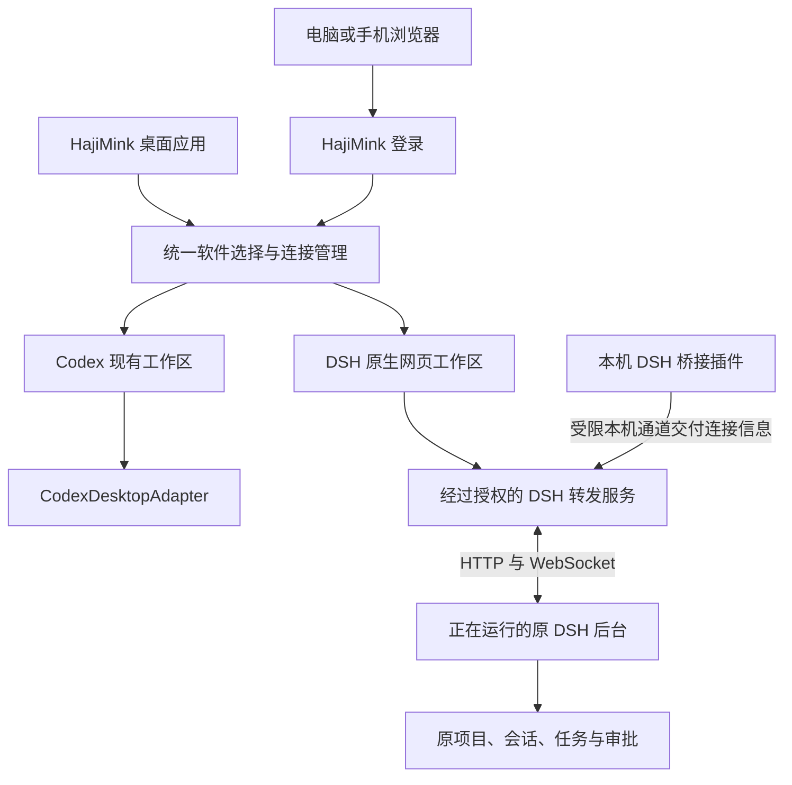

# DSH 接入 HajiMink 方案

状态：设计方案，2026-10-31。已有独立本地预览验证，下面描述的是后续产品接入设计。

## 产品形态

HajiMink 负责软件选择、连接管理、登录、网关状态与托盘。切换到 Codex 时显示现有工作区；切换到 DSH 时显示原生 DSH 网页，由 DSH 提供项目列表、会话、消息、模型、工具日志与审批界面。

软件选择栏从当前 Codex 工作区中提取为外层组件。右侧内容按所选软件切换，避免在 DSH 原有项目栏旁再放一套 HajiMink 项目栏。软件切换保留已打开页面及草稿；首次选择时加载页面，后续切换优先恢复原页面。隐藏页面的后台任务继续由原 Agent 服务管理。页面被系统回收后，通过原软件支持的状态恢复机制重新加载，草稿恢复需要单独验收。

桌面端保留应用级软件栏、连接状态和设置入口。手机端将软件选择放进简短的顶部菜单，主体空间交给当前 Agent。外层负责视口、安全区与键盘占用空间，DSH 内层先使用其原有响应布局。跨页面主题与导航协作通过明确的桥接消息实现，避免依赖 DSH 内部 CSS 类名。

## 架构

将 Harness 的“业务动作接口”与“页面呈现方式”分别描述。建议增加 `surface.kind`，取值为 `conversation` 或 `native-web`。Codex 使用 `conversation`，DSH 使用 `native-web`。DSH 的聊天操作由原页面发给原服务，因此不需要给它实现空的 `catalog()`、`send()` 等适配器方法，也不应把它标记为支持尚未实现的 HajiMink 业务接口。

外层仅查询 DSH 的启用状态、连接状态、版本、兼容结果及页面启动信息。客户端取得的页面地址属于 HajiMink 转发入口，不包含 DSH 上游地址、启动令牌或本机凭据。

## 桌面与浏览器容器

Electron 桌面端使用独立 `WebContentsView` 承载 DSH，为其分配独立 session。保留 `contextIsolation`、进程隔离及受限导航；DSH 页面不获得网关管理、任意文件访问或命令执行的 Electron 桥。初版可不提供 preload，随后按已验证需求增加主题、状态和返回软件选择等有限消息。

浏览器端使用独立来源的 iframe。正式部署可以为 DSH 内容配置一个单独的 HTTPS 主机名，用户仍从 HajiMink 主入口选择软件。独立来源同时避免两套页面在 `/api`、资源路径、存储和脚本权限上相互影响。DSH 页面只允许指定的 HajiMink 主入口嵌入；主入口也只允许加载已配置的 DSH 来源。

本地模式可使用单独的回环端口。正式转发监听端口应由配置固定，供 Tunnel 指向；DSH 自己的随机网页端口由连接器重新发现。当前预览使用的 `4310` 属于验证实例，正式管理器应创建自己管理的实例并记录其归属。

## 登录与 DSH 认证

用户使用现有 HajiMink 密码或通行密钥登录。选择 DSH 后，主网关校验当前账号或设备权限，签发一次性、短时、限定 DSH 用途的启动凭证。外层通过表单 POST 将凭证交给 DSH 转发入口的专用启动接口；转发入口兑换后设置自己的 HttpOnly 会话 Cookie，并重定向到干净的根路径。启动凭证不放进 URL，原 HajiMink 登录 Cookie 与 DSH 上游 Cookie 均不转交给 DSH 页面。

DSH 转发会话绑定原 HajiMink 登录或设备授权。退出登录、撤销设备或会话过期时，拒绝后续 HTTP 请求并关闭已有实时连接。授权检查覆盖页面、资源、接口和 WebSocket，不以 iframe 已经加载作为持续授权依据。

已有预览解析本机凭据文件，并使用其中 `client-connection/browser-session` 记录生成原 DSH 可校验的短期 Cookie。它验证了接入可行性，但依赖内部认证格式。建议正式公网接入之前增加一个轻量 DSH 插件：插件通过 DSH 自己的连接服务取得合法启动地址，经仅当前系统用户可访问的本机通道交给网关；网关按 DSH 原有流程兑换 Cookie。凭据只留在网关进程内存。

首次启用插件需要安装到对应 DSH profile 并重载 DSH。启用流程应检查任务状态，安排在适合重载时操作。之后每次启动由插件自动报告实例、端口和连接信息。插件的服务接口与权限通道需要先验证，不能把它视为已经存在的官方集成接口。

## 生命周期与异常

网关管理器启动转发服务并等待 DSH 就绪。DSH 未运行时，工作区显示明确的离线状态及打开软件、重新检查入口。DSH 重启后，连接器撤销旧连接信息、发现新实例和端口，再建立新页面连接。

状态至少包括未启用、等待 DSH、连接中、已连接、认证失效和版本不兼容。版本或认证检查失败时暂停整个 DSH 页面入口；原生网页接入不能依靠现有 Codex 的能力开关可靠地变成只读页面。

转发层不自动重试消息提交，也不在重连后重放请求。原生 DSH 客户端在断线情况下的提交行为需要专门验收。停止和审批继续由原 DSH 确认执行，不再经过一套 HajiMink 审批表单。

关闭工作台窗口时按现有产品设置进入托盘，网关和远程入口继续运行。退出 HajiMink 会关闭其转发连接；已在 DSH 后台运行的任务仍由 DSH 管理。停止 DSH 自身属于单独的用户动作。

## 能力与范围

| 能力 | 首版接入方式 | 验证要求 |
| --- | --- | --- |
| 项目与历史会话 | 使用 DSH 原界面和原数据 | 两端核对同一会话与历史 |
| 消息、模型和实时输出 | 原生 HTTP、WebSocket 转发 | 专用测试会话验证 |
| 停止、审批与追问 | 原 DSH 流程 | 两端处理、过期请求和断线测试 |
| 插件页与设置页 | 原生网页能力 | 逐项确认页面路由和弹窗 |
| 上传与下载 | 原网页及受限容器能力 | 上传大小、二进制和下载授权 |
| 系统文件选择、打开外部软件等 | 按浏览器或 Electron 能力分别处理 | 无法提供时明确显示限制 |
| Windows 本机 DSH | 当前已验证的接入起点 | 完成本机产品验收 |
| Mac/Linux 使用远程 DSH | 连接同一个已授权网关 | 三端客户端与实体浏览器验收 |

原 DSH 的系统级或 Electron 专属功能不能因网页已显示就被视为全部兼容。Mac/Linux 本机 DSH 的安装发现与桥接需另行验证。

## 实施顺序

1. 完成本地工作区集成：提取软件选择栏，增加页面类型，建立 `DshWorkspace` 与桌面容器，接入发现、连接状态及软件切换保留状态。
2. 完成正式连接器：实现 DSH 桥接插件、本机凭据交付、版本检查和受管理的转发服务，替换预览中的内部 Cookie 构造方法。
3. 完成浏览器授权：实现限定用途的启动凭证、独立来源会话、注销联动、HTTP/实时连接持续校验及手机布局。
4. 在专用 DSH 会话验收后配置正式内容主机名与 Tunnel 路由，更新三端构建及部署文档。

预计涉及 `shared/types.ts`、`server/harness.ts`、`src/App.tsx`、`desktop/main.cjs`，并新增工作台外层、DSH 工作区、连接器、转发认证及 DSH 桥接插件模块。现有 `server/dsh-local-preview.ts` 可供提取流式 HTTP 与 WebSocket 转发部分，其本地信任和认证流程需要由正式实现替换。

## 验收条件

本地验收覆盖软件切换、项目与会话、草稿、模型、消息、实时输出、停止和审批。用专用会话检查桌面与网页显示一致，断网或超时后核对任务实际状态，确认没有重复提交。

恢复验收覆盖 DSH 重启换端口、退出、网关重启、页面刷新、多个标签页、凭据失效和版本变化。远程验收覆盖未登录访问、设备撤销、已有 WebSocket 关闭、伪造启动凭证、重放、来源不匹配及插件页隔离。

界面验收覆盖电脑、实体 iPhone/Android 的窄屏与横屏、输入法键盘、长会话滚动、文件下载和明暗主题。已有预览的浏览器视口检查可作为起点，不能替代这些验收。
