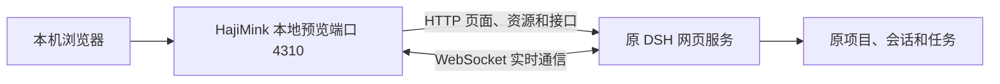

# DSH 原生网页本地预览

这是一项独立的本地接入验证。保持 DeepSeek Harness 桌面应用运行，在项目目录执行：

```sh
npm run preview:dsh
```

浏览器打开 `http://127.0.0.1:4310/`。Windows 上会根据 DSH 后台进程的监听端口自动发现网页入口；默认数据目录为当前用户的 `.dsh`，也支持 `DSH_HOME`。

需要指定端口或数据目录时：

```sh
npm run preview:dsh -- --upstream-port 49454 --port 4310
npm run preview:dsh -- --dsh-home /path/to/your/dsh-home
```



页面、插件、项目与会话均由正在运行的原 DSH 服务提供，不启动第二个 DSH 实例，不复制或修改原会话数据库。现有 HajiMink 网关及 DSH 软件选择栏保持现状；此预览尚未注册到正式网关，也未发布公网路由。

## 本机认证与访问范围

已在 DeepSeek Harness `0.2.1-rc.5` 验证。当前连接器仅支持凭据文件版本 1、`client-connection/browser-session` grant 版本 1，以及 v1 浏览器 Cookie 格式。它读取本机 `.dsh/.credentials.yaml` 中的这一条记录，按 DSH 已安装版本的认证格式生成短期上游 Cookie，交给原 DSH 服务校验。其他账号密钥不参与连接；凭据文件保持原状。Cookie 仅在服务端内存中使用，不返回浏览器，也不写入日志。

这依赖 DSH 的内部认证格式，正式接入时应优先增加由 DSH 插件主动提供连接凭据的方式。格式变化或初次验证失败时，预览拒绝启动。

预览固定监听 `127.0.0.1`，检查 Host、来源和本机连接；网页写入及 WebSocket 必须有同源 Origin。它提供完整的 DSH 所有者网页能力，不能直接套上公网转发。正式接入需要另行绑定 HajiMink 登录身份及来源限制。

预览关闭或浏览器断开后，已在原 DSH 后台运行的任务继续由 DSH 管理。预览不重试提交失败的操作；上游离线时返回连接失败。DSH 重启后网页端口可能变化，此时重启预览重新发现端口。

## 2026-10-31 验证记录

- 实机进程和监听关系已核对：随机回环端口为 DSH 网页；另一个 `4400` 监听属于 `dsh-peer-sync` 同步插件。
- 原生项目列表、会话列表、模型选项和输入框已在真实网页加载；收到 `/api/remote.mux` 的连接就绪及实时数据。
- 在浏览器模拟的 `1440 × 980` 与 `390 × 844` 视口完成渲染检查，无页面错误、失败请求或横向溢出。这不代表已在实体手机验收。
- 独立测试覆盖认证材料不泄露、来源限制、单次写入转发、流式响应、WebSocket 文本及二进制通信、未知认证格式拒绝和上游断线。
- 未向真实 Agent 发送任务；任务发送、停止、审批、附件及 Electron 专属能力尚未逐项实测。

运行自动化检查：

```sh
npx vitest run tests/dsh-local-preview.test.ts
npm run check
```
