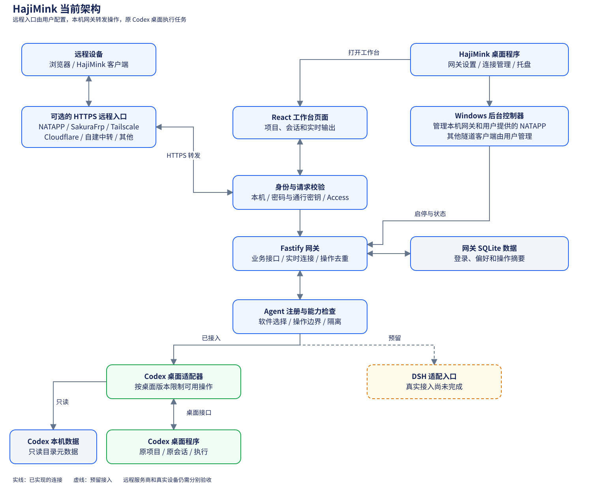

# HajiMink 项目进度

本文记录 2026-10-29 较早阶段的状态；最新的 `26.x` 策略、CLI 终端和验证范围见 [项目说明](../README.md)及[验收记录第 36 节](../VERIFICATION.md)

本文依据 2026-10-29 的项目源码、变更记录和验收记录整理

HajiMink 处于 `0.2.0-dev.1` 开发预览阶段，当前交付是 Windows 解包体验版

桌面程序、本机网关和 Codex 会话接入已经具备，真实公网配置和安装发布仍需验收

## 1 当前架构

桌面程序提供网关配置和工作台，后台控制器管理本机网关

远程设备可以通过用户配置的 HTTPS 加密访问入口连接网关

网关再通过适配器访问原 Codex 桌面会话

下图还标出了服务商选择与 DSH 预留入口：

图 1.1 HajiMink 桌面、远程入口和 Codex 会话的连接关系

服务商名称表示可配置的入口类型，公网隧道需要用户准备

Windows 版可管理用户提供的 NATAPP 隧道客户端，其他客户端由用户自行管理

DSH 是预留的 Agent 接入入口，真实连接尚未实现

[架构说明](ARCHITECTURE.md)包含组件职责和登录、消息流程

[Mermaid 图源](diagrams/architecture.mmd)可用于查看文本形式的流程图

## 2 当前可用范围

Windows 桌面提供首次网关引导、自选端口、连接管理和按服务商分类的配置指引

登录入口支持密码和通行密钥

远程入口可填写自己的 HTTPS 地址、域名或服务器 IP 地址，并提供连接检查

HTTPS 是加密访问协议，服务器 IP 地址同样需要对应的可信证书

检查结果不能证明服务器归属或持续连接正常

`26.1023.6123.0` 版 Codex 桌面处于部分兼容状态

使用者可以在已有项目中新建会话，向已连接且空闲的会话发送消息，并停止当前轮

设置、审批、问答回应和其他尚未验证的写入路径保持关闭，未知版本也会阻止连接

工作台支持会话查看、实时输出和断线恢复

网关记录操作标识，避免在结果不明确时自动重复提交

macOS 和 Linux 目前定位为远程客户端，本机 Agent 接入及跨平台安装尚待验证

## 3 最近改动

- 首次配置增加了密码或通行密钥选择、一次性设置码和浏览器入口
- 服务商稍后才提供地址时，可以先保护网关，取得地址后再完成绑定
- 网关页增加 NATAPP 文件选择和客户端启停管理
- 远程入口检查分别报告网页访问和实时消息转发，地址变化后会清除旧结果
- 网关端口可以自行选择，桌面窗口、设置页和托盘支持停止本机服务并退出
- 手动停止后的状态会在重新打开桌面时保留，连接资料保存失败时会提示重试
- 实时连接异常会保留草稿并阻止自动重发，后台控制器会核对自己管理的进程身份
- Codex 兼容性从只读扩展到受限的真实新建、发送和停止，未验证的动作继续由 Codex 桌面处理

## 4 验证现状

根据[验收记录第 35 节](../VERIFICATION.md)，最近一次源码回归通过 215 项自动测试、类型检查和发布边界检查

候选版使用隔离数据通过密码、虚拟通行密钥和后台控制流程

最终体验版通过停止、重开、退出和连接实际 Codex 的只读检查

根据[验收记录第 28 节](../VERIFICATION.md)，使用者授权的一次真实写入验证覆盖一个专用会话的新建、发送和停止

这组测试只覆盖一个样本，其他项目、运行状态和桌面版本仍需分别验证

此前一次通行密钥测试出现网关停止超时，后续复测未重现，原因仍未确定

真实公网服务商、可信证书、真实设备认证器和用户亲手首次配置仍需要实际验收

Windows 安装、升级和长期运行也需要验收

macOS 和 Linux 的构建、系统凭据保存与真实设备联调尚未验收

## 5 建议的下一步

由使用者打开 Windows 体验版，按首次引导选择端口和登录方式

公网连接需要使用者配置自己的服务商和地址

验收时分别检查远程登录、实时输出、手动停止及重开体验

遇到问题时记录页面提示，不共享密码、通行密钥或隧道令牌

完成首次使用验收后，再处理安装升级、长期运行、其他桌面平台以及 DSH 接入

已验证的操作范围、失败记录和复测边界以 [验收记录](../VERIFICATION.md)为准
